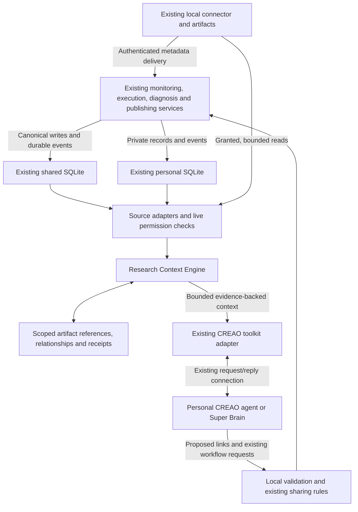

# Research Context Engine — architecture proposal

**Implementation note:** This is the pre-implementation assessment approved for development. The first workflow is now implemented; see [current contracts and limitations](research-context-engine.md) and build-plan step 11.

Status: proposal for review, 2026-10-25. Based on ExpandRG 0.14.1 (`1b0a067`) and the supplied `SimGuard_Research_Context_Engine_Prompt.md`. No application implementation or database changes are included. “SimGuard” in the supplied brief does not imply a product rename.

## Recommendation

Add a deterministic, permission-aware context service over the existing stores. Keep their records authoritative. Add stable evidence references, general relationships, and idempotent event handling where those concepts are missing. Do not introduce another agent, a graph database, a vector database, a new dashboard, or a second copy of the research data.

The first acceptance workflow is:

**Simulation run → anomaly → investigation → evidence → finding.**

A successful query returns the authorized context of a run, including explicit gaps. It must not invent a code revision or parameter history for an older run that never captured them.

## 1. Existing architecture assessment

| Area | Implemented source of truth | Connection that is missing or incomplete |
|---|---|---|
| Projects, researchers, agents | `workspaces`, `members`, `projects`, `project_members`, `agents` in shared SQLite | Reuse their IDs and policies; no replacement identity directory |
| Simulation observations | `simulation_runs`, `run_points`, `run_alerts` in shared SQLite | No durable general link to a code/input snapshot or investigation |
| Saved executable versions | Connector `simulation.json`, retained snapshot/work copies, snapshot fingerprint, runtime, `backend_run_id` | No Git commit/dirty-state capture; parent version is a display number |
| Experiments | Connector JSON and copied project/output files, experiment/set IDs, changed parameter values | No explicit originating run/anomaly/investigation; changes are not a complete effective parameter snapshot |
| Investigations | Per-member `private_episodes`; CREAO results and private drafts | Source run, source alert, and immutable evidence are not reliably persisted together |
| Group knowledge | `shared_findings`, approvals, notes, finding links, `finding_runs` | Finding links only connect findings; `finding_runs` allows one primary run per finding |
| Graphs | Private `visualizations` and history; dataset IDs and exact data fingerprints | Graph-to-run links live inside graph JSON, without a common reverse lookup |
| Tasks | Worksheets and items, with finding references | Existing teaching records can later be exposed through an adapter |
| CREAO access | Personal/hub clients, bounded `tool_requests`, checked `graph_ops` | No unified research-context tool or relationship proposal contract |

The shared database is `superbrain.db`; personal databases are `private/<member_id>.db`. Connector artifacts remain in the local ExpandRG home. Physical placement in the shared database does not make all run data readable by every project member.

Important evidence from the code:

- [Database placement](../backend/db/database.py#L1), [run/anomaly tables](../backend/db/schema.py#L236), [personal episodes/drafts](../backend/db/schema.py#L282), and [saved graphs](../backend/db/schema.py#L344) already provide most domain records.
- [Saved simulation preparation](../local_connector/simulations.py#L62) fingerprints retained code **and inputs**. This is an execution snapshot identity, not a Git revision. [Experiments](../local_connector/experiments/manager.py#L51) save changed parameters, not every effective parameter.
- [Diagnosis recording](../backend/orchestration/diagnosis.py#L156) persists symptom, reply, issues, context-finding IDs and diagnostic graphs. The API's source simulation ID is present in its transient job result but not explicitly retained there with the alert and selected evidence.
- `private_episodes.run_id` references the separate private `runs` table, not `simulation_runs`. Also, a diagnosis result's `run_id` is a **CREAO execution ID**. These must not be conflated.
- [Jobs](../backend/orchestration/jobs.py#L36) are memory-only. A job ID cannot be the permanent investigation identity.
- [Run reports](../backend/monitoring/runs.py#L58) currently append points and generate fresh alert UUIDs. A lost acknowledgement followed by retry can duplicate domain data; deduplicating only new context edges would not fix that.

**Built versus planned:** simulation preparation/execution, monitoring, personal/hub conversation, findings, worksheets and visualization are implemented. The Context Engine, structured paper/equation records, onboarding, and a complete autonomous investigation orchestrator are not implemented. Experiments use copies with resource limits; they are not filesystem/network-isolated sandboxes.

## 2. Proposed architecture and boundaries



`Overlay` means tables inside the existing privacy-separated databases, not a new unrestricted central database. Backend components call the service directly. CREAO uses the existing app-mediated toolkit; the engine does not require new cloud tools or another reasoning model.

Suggested implementation boundary: `backend/context_engine/` with small modules for models, source adapters, retrieval/policy, scoped persistence, and event application. Reuse `evidence_policy`, current permission functions, and existing source readers.

The engine owns reference resolution, relationship traversal, provenance, completeness reporting, and bounded retrieval. Existing services continue to own simulation execution, numeric calculations, diagnosis, publication, verification, and worksheets.

### Permission rules

1. Resolve a reference through its original store and current membership policy. Project membership alone must not reveal another researcher's private experiments, investigations or graphs.
2. Authorize both endpoints **before** returning a relationship. Hidden records must not leak through IDs, titles, counts, or relationship listings.
3. A shared finding does not grant access to its linked private run or evidence. Owners can retain private support links; other readers receive only the material already authorized for sharing.
4. Recheck file grants when reading artifacts. A saved file reference is not permanent read permission. Absolute paths, credentials, raw repositories and unbounded logs do not enter CREAO context.
5. Separate permission to inspect from permission to disclose. A workflow chooses `private_analysis` or `project_publication` on the server. The agent cannot choose a broader disclosure policy.
6. Preserve audience-safe cross-project retrieval for publishable results through the existing readership-intersection rule. Current toolkit searches are broader than that rule and need an explicit purpose-aware adapter.
7. Finding **notes** may be agent context under current rules; finding **comments** are human-only and must remain excluded.
8. Preserve current sharing behavior: diagnosis drafts require approval; eligible personal-chat results may auto-share as **hypotheses**. Publishing is not scientific verification.

The assessment also found inconsistent membership rechecks in run-owner access and diagnosis/overview job polling, and locally trusted unauthenticated connector routes alongside authenticated saved-simulation routes. Establish a consistent live authorization policy for the new adapters; do not describe the existing connector as uniformly authenticated or widen its access by adding a generic context endpoint. Authentication itself remains a local prototype.

## 3. Minimal data model

### Reuse existing domain records

Use a common **response envelope**, not a new universal record table:

```text
ResearchRecord {
  ref, kind, workspace_id, project_id, owner/scope,
  created_at, updated_at,
  native_status, scientific_state,
  source_revision, provenance,
  completeness, authorized_summary
}
```

`ref` is typed and store-scoped. Preserve `run:<id>`, `exp:<id>` and `base:<set_id>` aliases already used by graphs. Add typed references for anomalies, existing private episodes, evidence artifacts, findings and graphs. Resolve local experiment aliases in the authenticated owner's scope. Reuse all existing IDs; do not re-key databases.

New contracts use distinct names: `simulation_run_ref`, `investigation_ref`, and `provider_run_id`. A label, graph title, file name, display version, or CREAO execution ID is not a simulation identity.

### Three small additions

| Structure | Minimal contents | Reason |
|---|---|---|
| `context_artifacts` | Artifact ID, project/owner, kind, stable source key, digest, opaque locator, bounded metadata, capture time/provenance | New identities only for missing code/input snapshots, selected evidence and output artifacts. Reuse existing snapshots; keep large contents outside SQLite |
| `context_links` | Source ref, predicate, target ref, project/scope, assertion status, provenance event, optional evidence refs | General relationships with forward/reverse indexes; unique scoped source/predicate/target prevents duplicate edges |
| `context_events` | Producer/event key, schema version, subject ref, source revision, timestamp, payload hash, small payload, application status | Durable ingestion receipt and pending projection/reconciliation work; no external event platform |

Personal artifacts and links stay in the owner's existing database. Shared rows contain only references/metadata eligible for the group's current sharing rules. A private investigation can link to a shared run or finding without copying its content into shared storage. References across databases cannot use SQLite foreign keys: validate them through adapters and handle deletion/revocation explicitly.

Code metadata can include an execution snapshot digest, input digest, optional Git commit, and dirty state. Missing Git metadata stays unknown. A dirty working tree requires an exact snapshot identity; its HEAD commit alone is insufficient. Capture metadata through a trusted read-only connector path without copying `.git` or exposing repository credentials.

Evidence references include an immutable snapshot/artifact ID, relative file/range or output location, content digest, capture time and origin. A pointer to a mutable current file is insufficient. Store approved excerpts only when necessary; otherwise reference an existing retained snapshot. Do not create paper/equation records yet.

### Scientific state and provenance

- **Observation:** a recorded measurement or detected anomaly; it does not prove a cause.
- **Hypothesis:** an agent/researcher explanation not yet tested.
- **Tested hypothesis:** a linked diagnostic test completed with a recorded outcome; completion does not establish correctness.
- **Verified finding:** an authorized human review, with evidence references and reviewer/time provenance.
- **Inconclusive result:** an explicitly recorded inconclusive evaluation.

Keep existing native labels. Do not automatically translate every `supported` finding into a completed test, or every `unresolved` record into an inconclusive experiment. Legacy verification without detailed provenance should retain its existing label and disclose the missing provenance. An agent's “confirmed” label never promotes a finding to verified.

Structural links such as `has_anomaly`, `uses_snapshot`, `produced_result`, `investigates`, `cites`, and `derived_from` can be recorded automatically from actual service actions. Scientific links such as `supports`, `contradicts`, `causes` or `resolves` need an explicit assertion origin and review state. CREAO-inferred links start as proposals/hypotheses.

## 4. Integration contracts

These are proposed interfaces, not existing endpoints.

| Operation | Existing integration point | Contract and effect |
|---|---|---|
| Register execution/experiment | SimulationManager, ExperimentManager, run creation | Reference existing IDs; capture exact snapshot/input identities, available parameters and optional originating run/anomaly/investigation. Record parameter completeness |
| Record anomaly | `add_report` and existing monitor | Persist the existing anomaly once, then link it to its run. Do not create a parallel anomaly store |
| Link investigation | `record_diagnosis` / private episode creation | Persist source run, source alert, selected evidence refs and CREAO provider ID with the existing episode and its links |
| Retrieve run context | New `ContextEngine.get_run_context` and authenticated read route/tool | Resolve one run and its authorized code, parameters, result summaries, anomalies, investigations, evidence and findings |
| Find related research | New bounded query on existing adapters | Default to current project; use declared parameter names, explicit tolerances and comparable units. Report the matching criterion; do not infer parameters from labels |
| Propose relationship | Existing checked-operation/tool pattern | Validate actor, endpoints, predicate, scope and evidence. CREAO can propose associations, not set verified status or alter measurements |
| Save findings/evidence | Existing private draft and evidence workflow | Keep draft ownership/status; attach stable support refs to the existing investigation/finding |
| Share eligible findings | `approve_draft`, `share_from_chat`, existing offboarding rules | Preserve approval/auto-share policies and audience filtering; publish no private payload or newly accessible private edge |

An example read tool is `get_research_context({ref: "run:…", include: [...]})`. Add it to the existing `tool_requests` allowlist. Unknown operations, unrestricted SQL, code execution and arbitrary file access remain unsupported. Internal service events should use direct calls or authenticated existing ingestion paths; an endpoint named “internal” is not an authorization mechanism.

### Bounded context result

Return a root reference; typed records and relationships; provenance; source references; per-category completeness; and a continuation cursor when truncated. Results expose statistics and at most the existing forty-point series summaries by default. Start with a 12,000-character context budget, approximately thirty records/sixty edges, and explicit pagination rather than silently omitting the rest. Tune these limits with tests.

The core run query should explicitly gather the complete workflow's record categories, rather than depend on an arbitrary two-hop graph search. Large data stays in existing artifacts. Missing revision/parameters are `not_captured`; an unavailable connector is `offline`; modified/missing owned evidence is reported unavailable. Unauthorized records and their edges are excluded without revealing that they exist.

### Event delivery and retries

Example envelope:

```text
{ producer_id, event_id, schema_version, type,
  project_id, subject_ref, source_revision, occurred_at,
  payload: { existing source IDs and bounded metadata } }
```

The receiving workflow derives actor/owner from authenticated context, not the payload. Replaying the same producer/event key and payload returns the original acknowledgement. Reusing the key with different content is rejected. Older source revisions cannot overwrite newer metadata.

Fix idempotency at **source ingestion**, including stable client-run IDs and report/anomaly IDs. Freeze a report batch while retrying it; define deterministic handling for overlapping samples at `(run, metric, step)`. Domain writes and their receipt/pending event belong in one transaction in the source's existing database.

Project the pending event into context links idempotently. Context projection failure must not stop a simulation or lose its observations. For connector JSON, retain a small pending-event list with an atomic metadata write and retry it until acknowledged. Backend/private/shared stores are not one atomic transaction: preserve existing publication replay recovery and use scoped pending events plus startup reconciliation across those boundaries. No Kafka, broker, distributed transaction, or continuous CREAO calls are needed.

## 5. Incremental build plan

The existing build plan should be updated after this proposal's decisions are established. The proposed next item is **Research Context Engine**, ahead of new visualization/onboarding expansion.

1. **Policy and references.** Define typed envelopes, live access/disclosure rules and additive schema/migration behavior. Add source adapters and read-only run context using only existing facts. Prove that a leader does not acquire private investigation/graph access.
2. **Reliable provenance capture.** Add source report/event idempotency, exact execution/input identities, selected immutable evidence refs, and stable run-to-output metadata. Do not backfill invented revisions into legacy runs.
3. **Complete the core workflow.** Persist run→anomaly→existing investigation episode→evidence→draft/finding links. Record diagnostic experiments as tests of that investigation/hypothesis. Add forward and reverse lookup and restart reconciliation.
4. **Connect CREAO.** Expose bounded context retrieval and controlled relationship proposals through the current toolkit. Replace duplicated context assembly incrementally in diagnosis/chat while preserving sharing and redaction behavior. Measure payloads/call counts; do not promise lower CREAO latency without measurement.
5. **Reuse current consumers.** Project graph dataset references and worksheet finding references into the same layer; support reverse discovery without redesigning their UI or numerics.

Only after these checkpoints pass should the engine gain structured papers, equations, code-function relationships or onboarding. Those are extension points, not tasks in the first implementation.

Migration must preserve existing data. The current database rejects incompatible schema versions and suggests a reset; do not use that path for this feature. Prefer additive tables first. Before changing existing constraints or columns, add and test a non-destructive migration. Backfill only provable relationships from `finding_runs`, draft episode IDs and graph specs; mark legacy/incomplete provenance explicitly.

## 6. Validation and first-version acceptance

| Check | Required evidence |
|---|---|
| Complete core chain | One real fixture run produces an anomaly, an existing investigation episode, immutable evidence and a draft; publication links the same finding back to that chain |
| Accurate CREAO context | Mock CREAO receives correct IDs/statistics/verification labels and bounded summaries; no entire repository, hidden record, human-only comment, credential or local absolute path |
| Immutable provenance | Editing the original code/input/log after capture cannot change the old run's evidence; dirty snapshots and repeated runs remain distinguishable |
| Idempotency | Retried start/report/completion/publication events, including lost acknowledgements and restarts, create one logical run/anomaly/link and preserve valid sample updates |
| Access and disclosure | Another researcher cannot retrieve private runs or discover hidden edge counts; leaders see allowed runs without private investigations; removed members and revoked grants take effect during retrieval and long jobs |
| Scientific reliability | Agent assertions remain hypotheses; a completed test can be inconclusive; only a permitted human action can verify a finding; sharing alone never verifies it |
| Partial/offline operation | Legacy unknowns, thinned measurements, changed/missing artifacts and offline connector reads are explicit; available context still loads within its budget |
| Safe rollout | Migrations preserve old databases; a crash between scoped stores reconciles without duplicate publication; feature-disabled paths and existing tests continue to work |

First-version acceptance: an authorized caller supplies a simulation run ID after a backend restart and receives its persisted code/input identity when captured, parameter completeness, numerical summaries, anomalies, authorized investigations, immutable support references and related findings. The same query for a legacy run returns honest missing fields. Traversing a shared finding never widens access to personal memory.

This proposal has not changed application code, run tests, invoked CREAO, migrated data, or altered the existing build plan.
